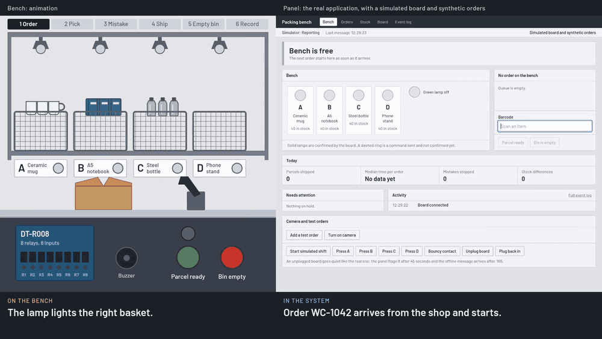
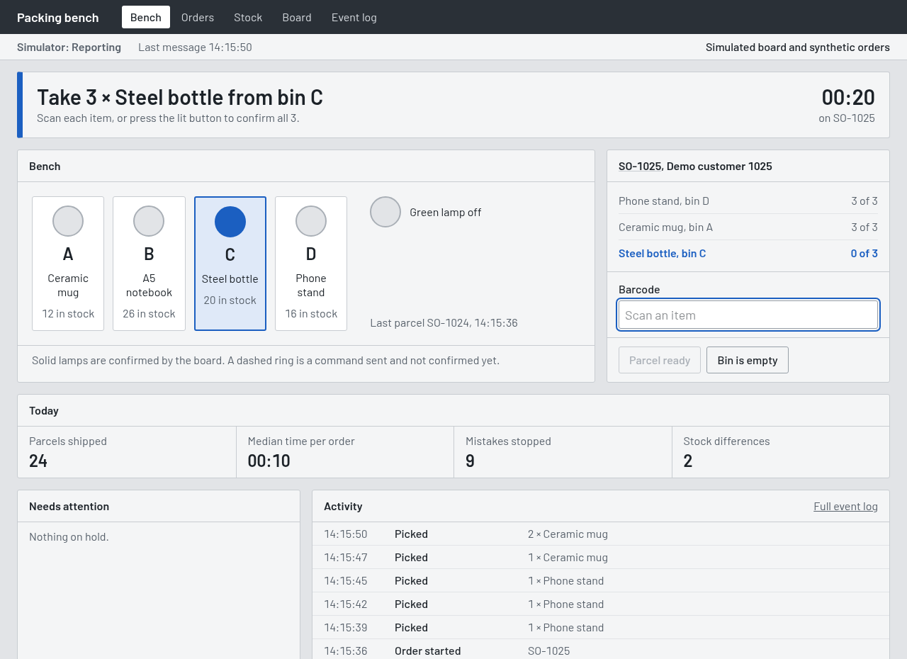
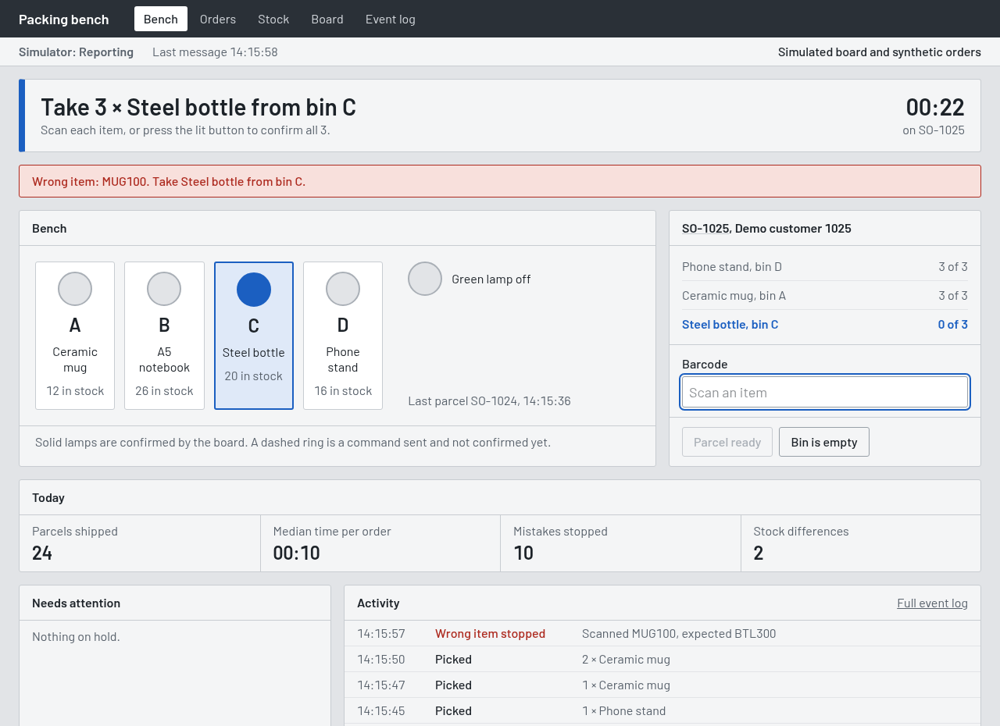
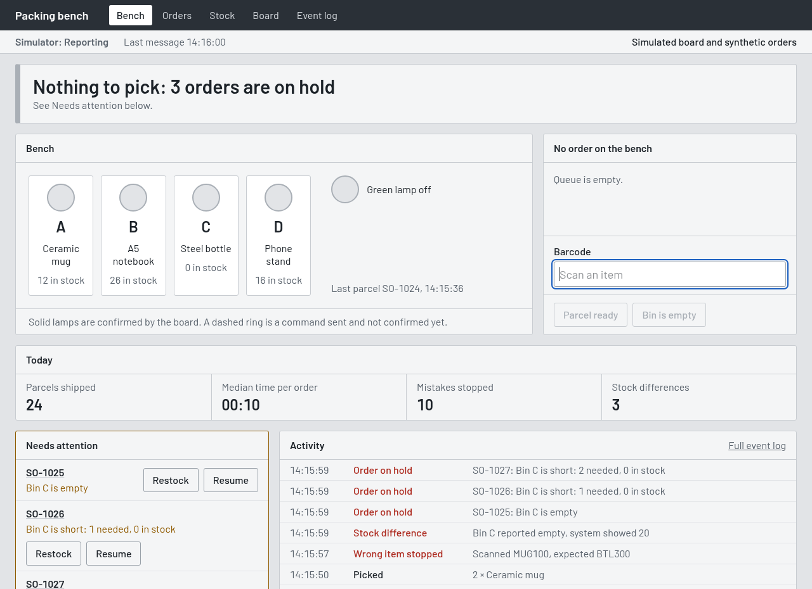
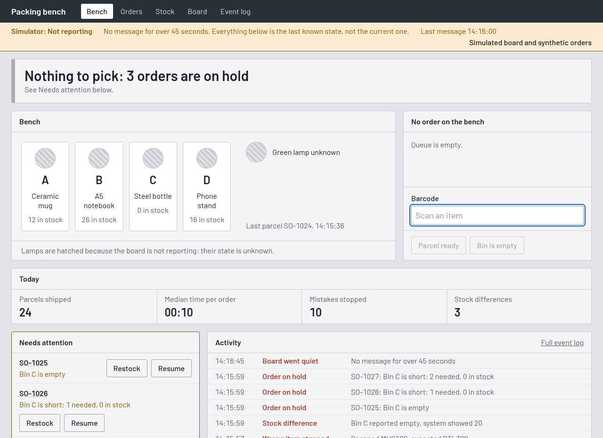
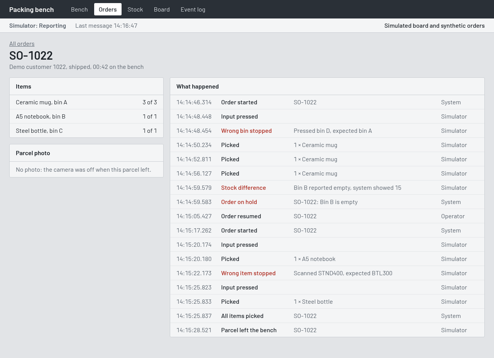
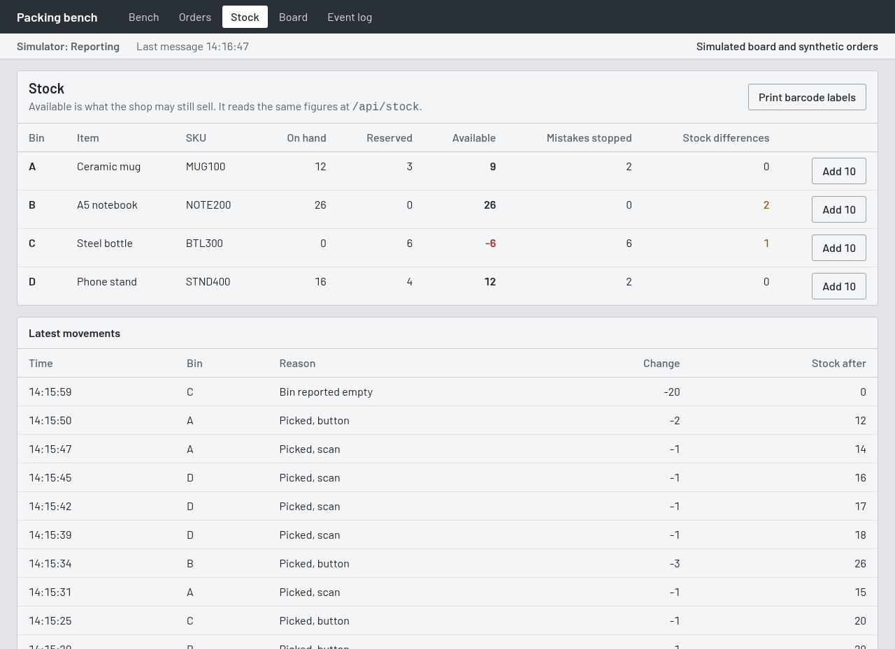
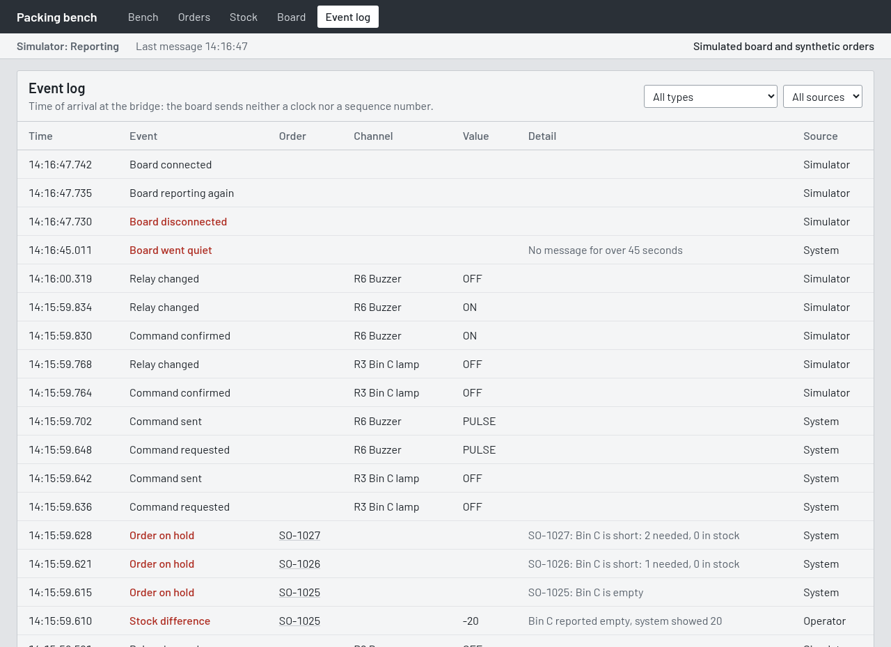
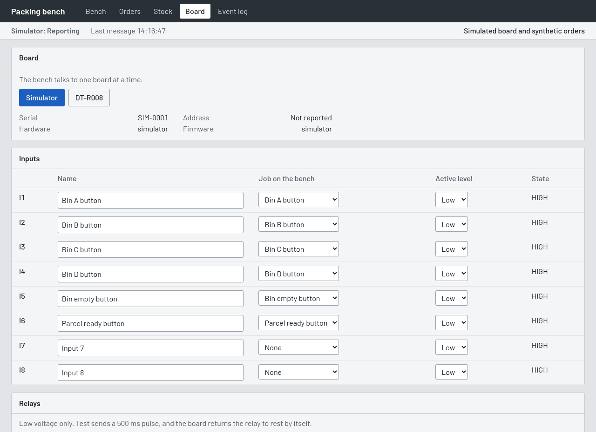
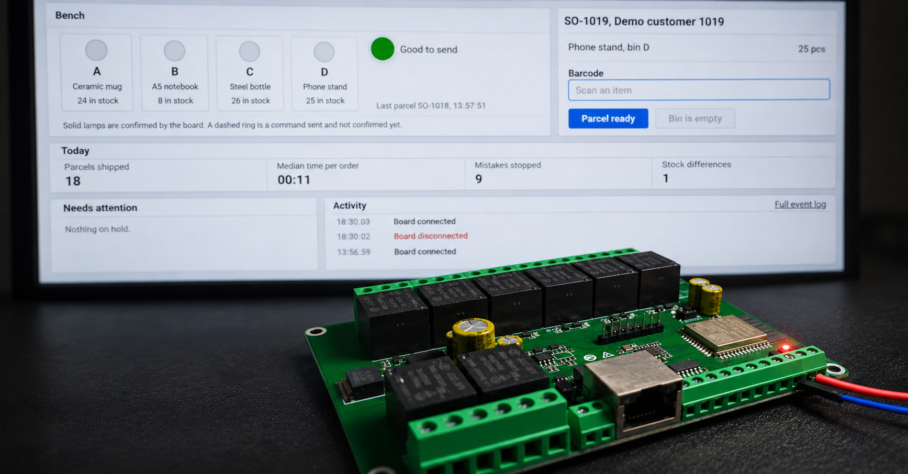

# Physical Workflow Bridge

**A pick-to-light packing bench built on a Dingtian DT-R008 relay board.** A lamp shows the operator which bin to pick from, a button or a barcode reader checks the pick, and every step lands in the order record.



*Excerpt of the simulation. The bench on the left is an animation, the panel on the right is the real application. See the [full 54-second video](docs/media/bench-simulation.mp4) and [what is real in it](docs/video.md).*

> **Demonstration prototype, not a product.** The panel and the workflow run for real, and the board side was tried on a real DT-R008. The physical bench was never built, orders are synthetic, there are no logins, and it runs on a local network only. Every figure in the pictures comes from a simulated shift: none of them is a measurement.

[Purpose](#purpose) | [The panel](#the-panel) | [What happens on the bench](#what-happens-on-the-bench) | [What is real](#what-is-real-and-what-is-simulated) | [Components](#components) | [Run it](#run-it) | [With the DT-R008](#with-the-dt-r008) | [How it is built](#how-it-is-built) | [Known limits](#known-limits) | [Levixflow](#levixflow)

## Purpose

This project started from a spare board. A Dingtian DT-R008, a few years old, was left over from an earlier project, and this small project was a way to reuse it. The board came first, then the problem to put it to work on: it was not chosen for this job, and it is not necessarily the best choice for this application. Its limits are under [Known limits](#known-limits), and only the adapter would change with [another board](#another-board).

Shops and warehouses usually have software on one side and people's hands on the other. The order is on a screen, the item is on a shelf, and what happens between the two is known only to the person doing it. Mistakes and stock differences come out later, if at all.

This project closes that gap at small scale: a physical action enters a business process. Pressing a button or scanning an item is recorded, checked against the order, and changes what the shop can still sell. When the board stops answering, the panel says so instead of showing old data as if it were current.

It was built by [Levixflow](https://levixflow.com), which makes [custom software for companies that sell and ship goods](https://levixflow.com/en/solutions): automated checks, connections between programs and management systems. This demonstration takes the same kind of work one step further, from the software to the packing bench. It is here to show the approach and to be read, run and reused. It is not for sale.

## The panel

These pictures come from the running application, with the board simulator on.

<table>
<tr>
<td width="50%">

<br><b>Bench.</b> One instruction at the top, the lit bin, the order and the barcode field. Solid lamps are confirmed by the board; a dashed ring is a command sent and not confirmed yet.
</td>
<td width="50%">

<br><b>Wrong item.</b> The scan is refused, the buzzer sounds, nothing changes, and the mistake is recorded.
</td>
</tr>
<tr>
<td>

<br><b>Bin empty.</b> The operator reports it. The difference between system and shelf is recorded, and the orders that bin cannot cover wait in <i>Needs attention</i>.
</td>
<td>

<br><b>Board goes quiet.</b> After 45 seconds without a message the lamps turn hatched: their state is unknown, and the panel says this is the last known state.
</td>
</tr>
<tr>
<td>

<br><b>Order record.</b> The whole story of one order: who did what, when, and how it was checked.
</td>
<td>

<br><b>Stock.</b> On hand, reserved and available for each bin, with every movement and its reason. The same figures are served at <code>/api/stock</code>.
</td>
</tr>
<tr>
<td>

<br><b>Event log.</b> Every signal and command in order, with its source: board, operator or system.
</td>
<td>

<br><b>Board.</b> Choose the simulator or the DT-R008, and give each input and relay its job.
</td>
</tr>
</table>

## What happens on the bench

1. An order arrives, from the panel or from a webhook shaped like a WooCommerce order.
2. The lamp on the right bin lights up, and the panel says what to take.
3. The operator scans each item, or presses the lit button to confirm the line. A wrong bin or a wrong code sounds the buzzer and changes nothing.
4. With everything picked the green lamp comes on.
5. *Parcel ready* ships the order, the webcam, if on, photographs the parcel and the next order starts.

Exceptions are the useful part:

- **Bin empty:** the operator reports it, the difference between system and shelf is recorded and the order goes on hold until restocked.
- **Board goes quiet:** after 45 seconds the panel says the data is the last known state, lamps turn to hatched and scans are refused.

What a scan proves: the code read matches the expected item. What a button proves: a person confirmed. Neither proves what is in the parcel, and the panel records which one was used.

## What is real and what is simulated

| | |
|---|---|
| Inputs, command confirmation, reconnection, PC standby, broker loss | Tried on the real DT-R008, with a jumper in place of a button |
| A whole order on the real relays: bin lamp, buzzer on a wrong item, green lamp, shipped, all relays off | Tried on the real DT-R008 over MQTT, relays with no load: 63 to 128 ms from command sent to relay confirmed. The steps were run from the application, not from physical buttons |
| The whole flow with buttons and exceptions | Tested against the simulator: see the test suite |
| Inputs, on the real board | Only I1 was tried, with a jumper. I2 to I6 use the same code and were not tried |
| Real buttons, lamps, reader, webcam | Not built. The [simulation video](docs/video.md) shows the bench as an animation next to the real panel |

## Components

### To try it

A computer with [Docker](https://www.docker.com/products/docker-desktop/). Nothing else: no board, no parts. A simulated board and a simulated operator keep the panel moving.

### To connect a real board



| Qty | Part | Job |
|---:|---|---|
| 1 | Dingtian DT-R008 | 8 inputs and 8 relays on the network. Tried on hardware V3.6J, firmware V3.1.2178A |
| 1 | 12 V DC supply, 2 A recommended by the manual | Powers the board |
| 1 | PC on the same local network as the board | Runs broker, bridge and panel |

### To build the physical bench

Optional, and never built: this is the planned list. Wiring and first power-up are in [docs/wiring.md](docs/wiring.md).

| Qty | Part | Job |
|---:|---|---|
| 4 | 30 mm arcade button with 12 V LED, blue | Bins A to D: lamp and button in one piece |
| 1 | 30 mm arcade button with 12 V LED, green | Parcel ready, and the green lamp |
| 1 | Red push button, normally open | Bin empty |
| 1 | Active buzzer, 12 V | Wrong pick |
| 1 | Inline fuse holder and 1 A fuse | Protects the 12 V lamp wiring |
| 3 | 5-way lever connectors | The +12 V, 0 V and input GND buses |
| 1 set | Stranded wire, 0.5 mm², and spade connectors | Everything else |
| 1 | USB barcode reader, 2D imager | Item scans |
| 1 | USB webcam | Parcel photo |

Low voltage only: never mains, machinery or safety devices.

### Software

| Part | Job |
|---|---|
| Laravel, Livewire, Tailwind CSS | Application and panel |
| SQLite | Orders, stock, events and commands |
| Mosquitto, php-mqtt/client | Messages between board and bridge |
| Docker Compose | Runs all of it, with nothing else to install |

## Run it

You need [Docker](https://www.docker.com/products/docker-desktop/) with Compose, and ports 8000 and 1883 free. You do not need the board. PHP, Node and the rest run inside containers.

Clone the repository and, inside its folder, run these two commands. They are the same in PowerShell, Terminal and Bash.

```bash
docker compose -f setup.yaml run --rm setup
```

```bash
docker compose up -d web bridge
```

The first one creates `.env` with random credentials and installs the dependencies: it takes a few minutes the first time, and it never overwrites an existing `.env`.

Open <http://127.0.0.1:8000>. The panel is the real application. It moves by itself because a simulated operator is working a shift on a simulated board: it picks, makes mistakes and hits empty bins.

### Work the bench yourself

At the bottom of the *Bench* page:

1. Press *Pause simulated shift*, and let any order already on the bench finish or work it through yourself.
2. Press *Add a test order*. The top of the page says what to take and from which bin.
3. Confirm the pick with *Press A* to *Press D*, which act as the buttons on the bins, or type a code in *Barcode* and press Enter: `MUG100`, `NOTE200`, `BTL300`, `STND400`. A wrong code is refused.
4. When the green lamp is on, press *Parcel ready*.

To cause trouble: *Bin is empty* during a pick, a wrong button, *Bouncy contact*, or *Unplug board*, which flags the data as stale after 45 seconds.

### Send an order from outside

The webhook takes a WooCommerce-shaped order, and stock is served as JSON. From Bash:

```bash
curl -X POST http://127.0.0.1:8000/api/orders -H "Content-Type: application/json" -H "Accept: application/json" -d '{"number":"WC-1042","billing":{"first_name":"Ada"},"line_items":[{"sku":"MUG100","quantity":2}]}'
```

```bash
curl http://127.0.0.1:8000/api/stock
```

### Stop it

`docker compose down` stops everything and keeps the data. `docker compose down -v` also deletes the database, so the next start begins from scratch.

### If something goes wrong

- `set APP_KEY in .env`: the setup command has not run yet.
- `port is already allocated`: another program is using port 8000 or 1883.
- Everything freezes after PC standby: standby stops broker and bridge. They come back when the PC wakes, or with `docker compose up -d web bridge`.

## With the DT-R008

1. Prepare the board with the [checklist](docs/board-analysis.md#4-board-checklist).
2. In `.env`, set:
   - `BROKER_BIND_IP`: address of the PC on the board's network
   - `DTR008_TOPIC_PREFIX`: `/dingtian/relay` followed by the serial
   - `DTR008_RELAY_PASSWORD`: the board's *Relay Password*
   - `SIMULATOR_ENABLED=false` to remove the simulator
3. On the board, under *Relay Connect*, enter the PC address, port 1883, and the `MQTT_USER` and `MQTT_PASSWORD` from `.env`.
4. Windows must allow port 1883 inbound.
5. Run `docker compose up -d web bridge` again, so the broker listens on the new address.

The active board is chosen on the *Board* page, where the mapping can be changed too. The *Test* button there pulses one relay.

| Channel | Job | Channel | Job |
|---|---|---|---|
| I1 to I4 | Bin A to D buttons | R1 to R4 | Bin A to D lamps |
| I5 | Bin empty button | R5 | Green lamp |
| I6 | Parcel ready button | R6 | Buzzer |

The barcode reader is a USB reader in keyboard mode: it needs no setup, and *Print barcode labels* on the *Stock* page prints the labels. The webcam runs in the browser, on the bench page.

### Check the board without the panel

`diagnostics/dtr008.php` talks to the board over HTTP, with no broker and no panel. It is useful before the first connection, or to tell a board problem from a panel problem. Replace the address with the board's own:

```bash
docker compose run --rm diag status 192.168.1.100
```

```bash
docker compose run --rm diag pulse 192.168.1.100 1 --confirm
```

The first prints the state of the eight relays and the eight inputs. The second switches one relay on for half a second, using `DTR008_RELAY_PASSWORD` from `.env`, and checks that it went back off. It refuses a relay that is already on, and it needs `--confirm`: check first that the relay drives no load that matters.

## How it is built

```text
Buttons         ─► DT-R008 ◄─MQTT─► Mosquitto ◄─MQTT─► bridge (artisan bridge:run)
Lamps, buzzer   ◄─┘                                      │
                                                         ▼
                                                      SQLite
                                                         ▲
Barcode reader, webcam ─► browser ─► Laravel + Livewire ─┘
```

Two Laravel processes and a broker. The bridge is the only process that talks to the board; the panel reads SQLite and queues relay commands for it.

The path is always the same: `BoardAdapter`, then `EventRecorder`, then `PackingBench`. Only the first link changes between `Dtr008Adapter` and `SimulatedAdapter`.

- `web/app/Device`: talking to the board, and the command queue
- `web/app/Events`: turning signals into events (duplicates, bounce, resync)
- `web/app/Workflow`: the business rules
- `web/app/Livewire`: the panel

A few things the board taught along the way, all in the [board analysis](docs/board-analysis.md):

- `{"type":"ON\/OFF"}` is valid JSON, and the board silently ignores it. PHP escapes slashes by default.
- A switched-off board announced `offline` 2 min 45 s later, so the panel watches the heartbeat instead.
- Retained messages come from the broker, so they prove nothing about the board being alive.
- A hand-moved contact gave 11 changes in 6 seconds, past the firmware's 40 ms debounce.
- With a wrong password the board answers `-7` over HTTP, where the manual says no reply, and nothing at all over MQTT.

### Another board

A different relay board needs one new class and two small changes. The workflow, the panel and the tests stay as they are.

1. A class that implements [`BoardAdapter`](web/app/Device/BoardAdapter.php), with four methods: `connect`, `poll`, `send` and `disconnect`. `poll` passes what arrived to the `EventRecorder`: `input()` and `relay()` for the channel states, `seen()` for every message, so the panel knows the board is alive. `send` returns once the command has left: the relay state that comes back is the confirmation. [`Dtr008Adapter`](web/app/Device/Dtr008Adapter.php) is the example to follow.
2. A row for the board, with its own `driver` name, in the [seeder](web/database/seeders/DatabaseSeeder.php), next to the DT-R008. The seeder only fills an empty database, so start again with `docker compose down -v`.
3. The choice of adapter in [`BridgeRun.php`](web/app/Console/Commands/BridgeRun.php), which today picks between the simulator and the DT-R008 only.

## Commands

```bash
docker compose run --rm test
```

```bash
docker compose run --rm --entrypoint php diag test.php
```

```bash
docker compose run --rm assets
```

The first runs the application tests, the second the HTTP diagnostics tests, the third rebuilds the CSS, which is only needed after changing it: the build is in the repository. After changing PHP code, run `docker compose restart web bridge`.

## Known limits

- The board sends no clock or sequence number: the time recorded is arrival at the bridge.
- A press during a disconnection is lost: the state is resynced, not the history. PC standby does the same, since it stops broker and bridge.
- MQTT without TLS and a 4-digit relay password: fit for a controlled LAN, never the Internet.
- The panel has no login and binds to 127.0.0.1, and so does the webhook.
- A wrong password over MQTT gets no reply: it shows up as a missing confirmation.
- One bench, four bins, one order at a time. This shows the idea; it is not a warehouse system.

## Levixflow

The same kind of work in production, behind a real WooCommerce shop, is on the Levixflow page about [warehouse management for ecommerce](https://levixflow.com/en/ecommerce-warehouse-management).

## License

[MIT](LICENSE). Made by [Levixflow](https://levixflow.com).

## Trademarks

Dingtian and WooCommerce are trademarks of their owners. This project is not affiliated with them.
